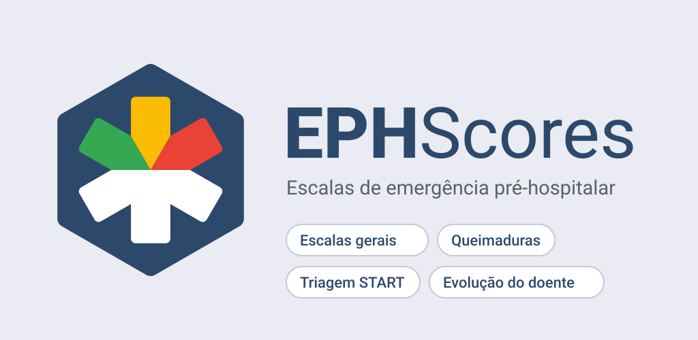

# EPHScores

## O que é?

EPHScores ajuda profissionais de emergência pré-hospitalar a avaliar vítimas
de forma rápida e simples, no terreno.

- **Evolução do doente:** cada avaliação é registada com hora e duração;
  as respostas ficam como referência para a seguinte, e a página
  *Evolução* mostra a tendência de cada escala e partilha um resumo para a
  passagem de dados no formato ISBAR, como no verbete, para qualquer
  aplicação (mensagens, notas, e-mail ou Quick Share)
- **Histórico (Android):** os doentes finalizados ficam guardados durante
  30 dias numa base de dados cifrada, que só abre com o bloqueio de ecrã do
  telemóvel
- **Horas da ocorrência:** a caminho do local, chegada à vítima, contacto
  CODU, transporte e disponível, registadas com um toque a partir de uma
  bolha flutuante presente em todos os ecrãs
- **Sinais vitais:** os campos do verbete nacional (AVDS, FR, SpO₂, O₂, FC,
  PA, temperatura, dor por escala numérica ou de faces, e glicemia),
  registados uma vez e usados por todas as
  escalas que deles precisam; a NEWS2 fica calculada sem mais toques, com o
  índice de choque ao lado; nas crianças, FR, FC e PAS são comparadas com o
  normal para a idade
- **Vias Verdes:** hora de início dos sintomas e critérios das Vias Verdes
  AVC, Coronária, Sépsis e Trauma, assinalados automaticamente a partir dos
  sinais vitais, das escalas e do mapa de queimaduras
- **Escalas gerais:** Cincinnati, Glasgow (ECG), MGAP, NEWS2, ProACS, RACE e RTS
- **Escalas pediátricas:** APGAR, Glasgow pediátrica, FLACC, Triângulo de
  Avaliação Pediátrica (TAP) e PTS
- **Avaliação do queimado:** regra dos nove para adulto e criança, com grau por região
- **Triagem START:** algoritmo passo a passo e contagem de vítimas por
  prioridade, separada do doente
- **Contactos úteis:** linhas de apoio com chamada direta

### Feita para o terreno

- **100 % offline.** A versão de produção não pede permissão de Internet; nada
  sai do dispositivo, a não ser que o utilizador partilhe um resumo. Também
  não há cópias de segurança automáticas dos dados.
- **Botões grandes**, pensados para usar com luvas.
- **Nada se perde:** as respostas e as avaliações são guardadas a cada toque
  e sobrevivem ao fecho da aplicação.
- **Sem dados pessoais:** não há campos de identificação (apenas a idade),
  e só o último doente é mantido. "Novo doente" apaga o anterior.
- **Modo escuro** automático, para turnos noturnos.

> A aplicação é um auxiliar de cálculo. Não substitui a avaliação clínica nem
> os protocolos em vigor.

## Construída com

Interface em Material 3, com a paleta original (azul-marinho e cores de
semáforo).

## Onde instalar

- **Android:** [Google Play](https://play.google.com/store/apps/details?id=com.davidaraujo.ephscores)
- **iPhone / iPad:** abrir <https://ephscores-7e4eb.web.app> no Safari,
  tocar em *Partilhar* e depois em *Adicionar ao ecrã principal*. A aplicação web (PWA) fica guardada no
  dispositivo e funciona sem rede a partir da primeira abertura.

## Código-fonte

A aplicação é open source ([licença](LICENSE)). O projeto Flutter está em
[`ephscores/`](ephscores), com as instruções de desenvolvimento no respetivo
README.
