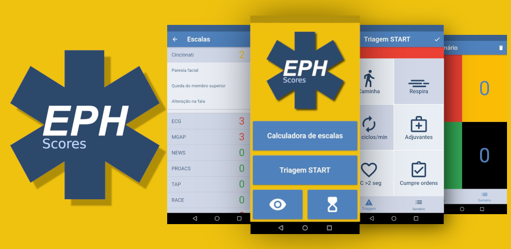

# EPHScores



## O que é?

EPHScores ajuda profissionais de emergência pré-hospitalar a avaliar vítimas
de forma rápida e simples, no terreno.

- **Evolução do doente:** cada avaliação é registada com hora e duração;
  as respostas ficam como referência para a seguinte, e a página
  *Evolução* mostra a tendência de cada escala e permite copiar um resumo
  em texto
- **Escalas gerais:** Cincinnati, Glasgow (ECG), MGAP, NEWS2, ProACS, RACE e RTS
- **Escalas pediátricas:** APGAR, Triângulo de Avaliação Pediátrica (TAP) e PTS
- **Avaliação do queimado:** regra dos nove para adulto e criança, com grau por região
- **Triagem START:** algoritmo passo a passo e contagem de vítimas por
  prioridade, separada do doente
- **Contactos úteis:** linhas de apoio com chamada direta

### Feita para o terreno

- **100 % offline.** A versão de produção não pede permissão de Internet; nada
  sai do dispositivo.
- **Botões grandes**, pensados para usar com luvas.
- **Nada se perde:** as respostas e as avaliações são guardadas a cada toque
  e sobrevivem ao fecho da aplicação.
- **Sem dados pessoais:** não há campos de identificação, e só o último
  doente é mantido. "Novo doente" apaga o anterior.
- **Modo escuro** automático, para turnos noturnos.

> A aplicação é um auxiliar de cálculo. Não substitui a avaliação clínica nem
> os protocolos em vigor.

## Construída com

[](https://dart.dev/)
[](https://flutter.dev/)

Interface em Material 3, com a paleta original (azul-marinho e cores de
semáforo).

## Onde instalar

- **Android:** [Google Play](https://play.google.com/store/apps/details?id=com.davidaraujo.ephscores)
- **iPhone / iPad:** abrir o site no Safari, tocar em *Partilhar* e depois
  em *Adicionar ao ecrã principal*. A aplicação web (PWA) fica guardada no
  dispositivo e funciona sem rede a partir da primeira abertura.

## Desenvolvimento

O projeto Flutter está em [`ephscores/`](ephscores).

```sh
cd ephscores
flutter pub get
flutter test          # testes das escalas, START, queimados e interface
flutter run
```

### Estrutura

| Pasta | Conteúdo |
|---|---|
| `lib/scores/` | Definição de cada escala como dados + cálculo (sem dependências de UI) |
| `lib/patient/` | Doente, avaliações registadas e resumo em texto |
| `lib/start/`, `lib/burn/` | Algoritmo START e regra dos nove |
| `lib/ui/` | Ecrãs; um único ecrã genérico desenha qualquer escala |
| `web/`, `scripts/` | PWA: manifesto, service worker e script de build |
| `test/` | Testes unitários e de interface |

Para acrescentar uma escala basta criar um `ScoreDefinition` em
`lib/scores/adult.dart` ou `pediatric.dart` e juntá-lo à lista.

### Logótipo e ícones

Há uma única fonte: `ephscores/assets/brand/logo.svg` (um emblema hexagonal
azul-marinho com a estrela da vida, cujos três braços superiores são verde,
amarelo e vermelho, as cores das escalas). A aplicação desenha o logótipo
a partir desse ficheiro, e todos os ícones (Android, iPhone/PWA, favicon,
loja) são gerados dele:

```sh
cd ephscores/scripts/icons && npm install && npm run generate
cd ../.. && dart run flutter_launcher_icons
```

Uma pré-visualização está em `UI/Images/logo-preview.png`. As cores do SVG
são procuradas por valor (`Palette` em `lib/theme.dart`); um teste garante
que continuam iguais.

### Compilar tudo (APK + web)

```sh
cd ephscores
scripts/build_all.sh                # analisa, testa e gera o APK e a web (PWA)
scripts/build_all.sh all            # também gera o app bundle (.aab)
scripts/build_all.sh --skip-tests --split apk   # só o APK, um por arquitetura
scripts/build_all.sh --deploy       # APK + web e publica a web (iPhone) no Firebase
```

Com `--deploy`, a versão web é publicada no Firebase Hosting depois de
compilada, e uma só chamada lança as duas versões (Android e iPhone). Precisa
do Firebase CLI (`npm install -g firebase-tools` e `firebase login`).

Os ficheiros Android ficam em `ephscores/dist/` (com a versão no nome) e a
web em `ephscores/build/web`. Precisa do Flutter no `PATH` e, para o Android,
do Android SDK (`flutter doctor` indica o que falta). No Windows, usar o Git
Bash ou o WSL. Sem `android/key.properties`, o Android é assinado com a chave
de debug: serve para testar, mas não atualiza a versão da Google Play.

### Publicar a versão web (PWA)

```sh
cd ephscores
scripts/build_all.sh web --deploy      # testa, compila e publica
# ou, passo a passo:
scripts/build_web.sh                   # build em build/web, com cache offline (sw.js)
firebase deploy --only hosting
```

O `firebase.json` e o `.firebaserc` (projeto `ephscores-7e4eb`) já estão
configurados; basta ter o Firebase CLI e fazer `firebase login`. O endereço
por omissão é https://ephscores-7e4eb.web.app.

A build inclui o motor gráfico e as fontes, sem depender de CDNs. Cada build
gera uma nova versão da cache, e os utilizadores recebem a atualização na
abertura seguinte.

### Publicar no Google Play

Criar `ephscores/android/key.properties` (fora do git) com `storeFile`,
`storePassword`, `keyAlias` e `keyPassword`, e depois:

```sh
flutter build appbundle
```

Sem esse ficheiro, a versão de produção é assinada com a chave de debug.
