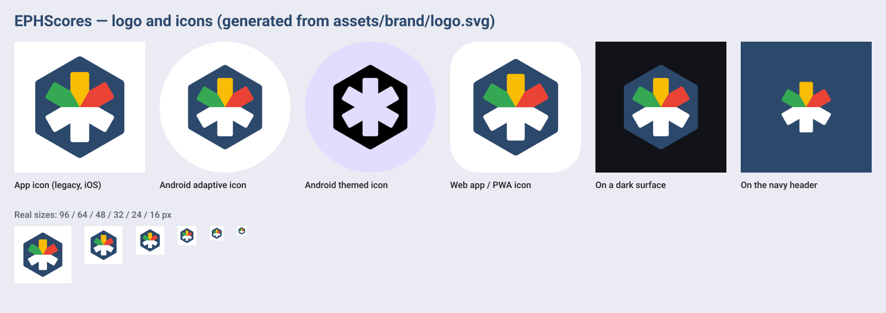
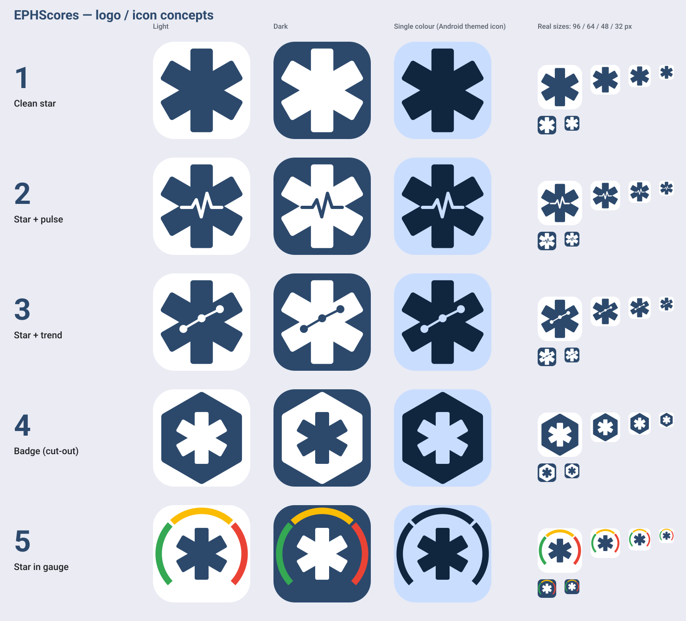

# Identidade visual — EPHScores

Este documento define o logótipo, as cores, o tipo de letra e as regras de
utilização do EPHScores, para que a aplicação, os ícones, o site e qualquer
material futuro (loja, apresentações, redes) tenham a mesma imagem.

## Logótipo

<p align="center">
  
</p>

Um emblema hexagonal azul-marinho com a **estrela da vida**. Os três braços de
cima são **verde, amarelo e vermelho**, da esquerda para a direita; os três de
baixo são brancos.

As cores dos braços são as cores de gravidade das escalas na aplicação (verde:
normal, amarelo: atenção, vermelho: crítico), lidas como um indicador do bom
para o crítico. O hexágono dá-lhe uma forma própria e legível mesmo em tamanhos
muito pequenos.

**Fonte única:** [`ephscores/assets/brand/logo.svg`](../../ephscores/assets/brand/logo.svg).
A aplicação desenha o logótipo a partir deste ficheiro e todos os ícones são
gerados dele; nunca se editam à mão.

## Onde aparece



| Ficheiro | Utilização |
|---|---|
| `ephscores/assets/icon/app_icon.png` (1024) | Ícone clássico Android e iOS, fundo branco |
| `ephscores/assets/icon/app_icon_foreground.png` | Camada do ícone adaptativo do Android |
| `ephscores/assets/icon/app_icon_monochrome.png` | Ícone temático do Android 13+ (uma só cor, com a estrela recortada) |
| `ephscores/assets/icon/play_store_512.png` | Ícone da loja Google Play |
| `ephscores/web/icons/Icon-192.png`, `Icon-512.png` | Aplicação web (PWA), cantos arredondados |
| `ephscores/web/icons/Icon-maskable-*.png` | PWA, versão para máscaras do sistema |
| `ephscores/web/icons/apple-touch-icon.png` (180) | Ícone no ecrã principal do iPhone (opaco: o iOS pinta de preto o que for transparente) |
| `ephscores/web/favicon.png` (64) | Separador do browser |

Dentro da aplicação, o logótipo aparece no ecrã inicial, no cabeçalho do painel
e na janela de informação.

## Cores

| Cor | Hex | No código | Utilização |
|---|---|---|---|
| Azul-marinho | `#2C496C` | `Palette.navy` | Emblema, cabeçalho, botões principais |
| Verde | `#34A853` | `Palette.green` | Resultado normal; triagem P3; braço esquerdo do logótipo |
| Amarelo | `#FBBC04` | `Palette.amber` | Atenção; triagem P2; queimadura de 1.º grau; braço superior |
| Laranja | `#FF9933` | `Palette.orange` | Queimadura de 2.º grau (não entra no logótipo) |
| Vermelho | `#EA4335` | `Palette.red` | Risco alto; triagem P1; queimadura de 3.º grau; botão 112; braço direito |
| Quase preto | `#202124` | `Palette.black` | Triagem P4; texto sobre amarelo |
| Branco | `#FFFFFF` | — | Braços inferiores; texto sobre as cores acima |

A fonte da verdade no código é `Palette` em `ephscores/lib/theme.dart`. Um teste
garante que as cores do SVG continuam iguais às da paleta.

## Tipografia

**Roboto**, já incluída na aplicação (licença OFL), para que a aplicação web
nunca dependa de fontes externas.

O nome escreve-se sempre numa só palavra, **EPHScores**, em dois pesos:
**EPH** em negrito forte (800) e *Scores* em normal (400).

## Regras de utilização

- **Tamanho mínimo:** 16 px. Abaixo disso o emblema deixa de se distinguir; aos
  16 px as três cores ainda se veem.
- **Espaço livre:** pelo menos 1/8 da largura do logótipo à volta.
- **Fundos:** o emblema traz o seu próprio azul-marinho, por isso funciona em
  fundo claro e escuro. Sobre o azul-marinho do cabeçalho o hexágono funde-se e
  só se vê a estrela, o que é aceite.
- **Não** mudar a ordem das cores, usar outras cores, deformar o logótipo nem
  acrescentar sombras ou contornos.
- **Não** recolorir o emblema; a única exceção é a versão de uma só cor (ícone
  temático, impressão a preto e branco), em que a estrela fica recortada.
- **Sem texto no ícone:** o nome aparece só dentro da aplicação, onde se lê.

## Animação

No ecrã inicial os três braços acendem-se em sequência (verde, amarelo,
vermelho) uma só vez e depois o logótipo fica estático. Quando o sistema pede
menos movimento, fica estático desde o início.

## Como chegámos aqui

Foram desenhados cinco conceitos, todos na mesma paleta, e comparados em
fundo claro, escuro, numa só cor e em tamanhos reais.



| # | Conceito | Resultado |
|---|---|---|
| 1 | Estrela limpa | Legível em todos os tamanhos, mas sem identidade própria |
| 2 | Estrela com linha de pulso | Boa, mas a linha esbate-se a 32 px |
| 3 | Estrela com linha de tendência | Boa ideia para a aplicação, fraca como ícone |
| 4 | Emblema com a estrela recortada | Muito legível a pequeno; **base do logótipo final** |
| 5 | Estrela dentro de um indicador | Gostou-se da cor, mas o indicador some-se a pequeno; **as cores foram para os braços do 4** |

O logótipo final junta o emblema do 4 com as cores do 5, aplicadas aos três
braços de cima. Os esboços em SVG e o gerador estão em
[`concepts/`](concepts/).

**Logótipo anterior (antes da versão 2.0):** a estrela azul-marinho com «EPH» em
itálico e «Scores» pequeno, num PNG com sombra incorporada. Foi substituído
porque o texto era ilegível em tamanhos pequenos, a sombra ficava visível em
fundos diferentes, a imagem tinha de ser ampliada (ficava desfocada) e não
havia versão de uma só cor.

## Atualizar a identidade

1. Editar `ephscores/assets/brand/logo.svg` (e `Palette`, se mudarem as cores).
2. Regenerar os ícones e a imagem deste documento:

   ```sh
   cd ephscores/scripts/icons
   npm install
   npm run generate     # todos os ícones
   npm run preview      # docs/design/logo-preview.png
   cd ../.. && dart run flutter_launcher_icons
   flutter test         # confirma que o SVG e a paleta coincidem
   ```
3. Atualizar este documento se algo do que descreve mudou.
